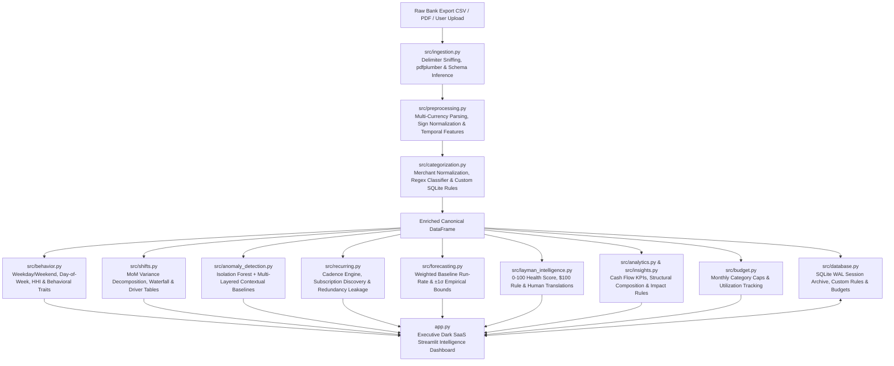

# 💳 SpendScope — Personal Financial Intelligence & Behaviour Analytics Platform

[](https://www.python.org/downloads/)
[](https://streamlit.io)
[](https://scikit-learn.org/)
[](https://plotly.com/)
[](https://sqlite.org/)
[](run_tests.py)

**SpendScope** is an executive-grade personal financial intelligence and behavioral analytics platform. It transcends conventional expense tracking by transforming raw bank exports (CSV or PDF) into intuitive, everyday financial stories: an empirical **0–100 Financial Health Score**, the **$100 Dollar-for-Dollar Rule** paycheck breakdown, behavioral profiles, variance decomposition, contextual anomaly diagnostics, recurring commitment audits, and forward-looking financial outlooks.

Designed for both everyday users (via conversational **Layman Mode**) and power analysts, SpendScope combines deep mathematical transparency with an executive SaaS dark navy (`#0B0F19`) and purple (`#6366F1`, `#8B5CF6`) aesthetic across 10 modular views.

---

## 🏛️ System Architecture



---

## ✨ Core Intelligence Modules

### 1. Layman Financial Intelligence & 0–100 Health Score (`src/layman_intelligence.py`)
- **Composite Financial Health Score (0–100):** Evaluates overall financial well-being across 4 transparent pillars (25 pts each):
  - *Savings Cushion (0–25 pts):* Rewards positive capital accumulation ($\ge 20\%$ savings rate = 25 pts).
  - *Fixed vs. Fun Balance (0–25 pts):* Benchmarks against the 50/30/20 guideline ($\le 60\%$ fixed bills = 20–25 pts).
  - *Spending Stability (0–25 pts):* Penalizes large unpredictable spikes ($\le 5\%$ anomalies = 25 pts).
  - *Subscription Efficiency (0–25 pts):* Audits duplicate memberships and commitment drag.
- **The $100 Dollar-for-Dollar Rule:** Translates abstract ledgers into an intuitive paycheck breakdown: *"For every $100 you earned, $38.50 went to fixed bills, $26.20 to essentials, $19.10 to dining & fun, and $16.20 stayed in your pocket."*
- **Conversational Takeaways & Action Tips:** Delivers 4 high-priority human-readable recommendations with actionable steps (e.g. automating savings transfers, setting weekend dining caps, canceling duplicate streaming apps).
- **Standalone Print / PDF Executive Briefing:** One-click generation of a print-ready HTML executive report that opens in any browser and prints cleanly to PDF (`Ctrl+P` / `Cmd+P`).

### 2. Spending Behaviour Intelligence (`src/behavior.py`)
- **Weekday vs. Weekend Analysis:** Quantifies spending velocity, transaction volume, and category bias across workdays versus weekends, including a normalized weekend intensity multiplier.
- **Day-of-Week Distribution:** Aggregates spending volume and average ticket size across all 7 calendar days to pinpoint peak and lowest outflow days.
- **Merchant Concentration & Economic Benchmark:** Computes the **Herfindahl-Hirschman Index (HHI)** and Pareto 80/20 vendor count to quantify reliance on primary merchants (`Diversified` <1,500; `Moderate Concentration` 1,500–2,500; `High Concentration` >2,500).
- **Structural Composition:** Decomposes monthly spending into *Fixed Commitments* (rent, insurance, utilities), *Discretionary Outflows* (dining, retail, entertainment), and *Flexible Living Costs* (groceries, transport, medical).
- **Empirical Behavioral Profiles:** Derives evidence-backed behavioural archetypes (e.g., *Weekend Velocity Skew*, *Concentrated Vendor Footprint*, *High Fixed Obligation Overhead*) strictly from mathematical distributions without subjective psychological claims.

### 3. Spending Shift Analysis & Variance Decomposition (`src/shifts.py`)
- **Month-over-Month (MoM) Bridge:** Calculates exact absolute and percentage changes between consecutive or user-selected monthly periods.
- **Factor Drivers:** Identifies the top expanding categories/merchants (greatest cost increases) and contracting categories/merchants (greatest savings).
- **Waterfall Step Model:** Powers interactive Plotly waterfall charts visualizing how baseline expenditure stepped up or down to arrive at the current month's total.
- **Data-Backed Narrative Summary:** Generates structured natural-language executive summaries explaining the mathematical drivers of spending shifts.

### 4. Explainable Anomaly Intelligence (`src/anomaly_detection.py`)
- **Unsupervised Isolation Forest:** Evaluates multi-dimensional features including log amount, category median ratio, day-of-week, and weekend indicators.
- **Multi-Layered Contextual Baselines:** Evaluates anomalies against category 75th percentiles, category median multiples, merchant transaction frequency, and ledger volume rank.
- **Contextual Categorization Tags:** Assigns clear diagnostic tags:
  - `First-Time High-Ticket Outlier` (new vendor with ticket size > 2.5x category median).
  - `Scale Outlier (>Nx Cat. Median)` (unprecedented spending surge in a familiar category).
  - `Merchant Baseline Surge` (known merchant charging significantly above historical median).
  - `Atypical Timing / Volume Outlier` (irregular cadence or frequency anomaly).
- **Strict Non-Fraud Framing:** Prominently frames all anomalies as statistical distribution outliers for operational and budgetary review, explicitly disclaiming confirmed fraud.

### 5. Cadence-Based Subscription & Leakage Audit (`src/recurring.py`)
- **Cadence Discovery:** Detects weekly, bi-weekly, monthly, and annual commitments based on regular payment intervals and low amount coefficients of variation ($CV \le 0.15$).
- **Subscription Leakage & Redundancy Analysis:** Scans active recurring obligations for concurrent overlapping services in identical domains (e.g., simultaneous subscriptions to multiple digital streaming or music services like Netflix and Spotify).
- **Fixed Commitment Ratio:** Calculates the percentage of monthly income or total expenditure dedicated to non-negotiable recurring charges.

### 6. Forward-Looking Financial Outlook (`src/forecasting.py`)
- **Multi-Component Baseline Forecast:** Combines the non-negotiable recurring commitment floor with a recency-weighted moving average of discretionary outflows.
- **Empirical Variance Bounds:** Projects next-month run-rates accompanied by empirical $\pm 1\sigma$ standard deviation confidence envelopes (Conservative Lower Bound vs. Aggressive Upper Bound).
- **Methodology & Analytical Limitations Disclosures:** Explicitly details baseline assumptions, data requirements ($\ge 2$ historical months), and acknowledges limitations regarding seasonal variations or sudden lifestyle changes.

### 7. Ingestion for CSV, TXT & PDF Bank Statements (`src/ingestion.py`)
- **PDF Statement Parsing:** Automatically extracts structured transaction tables and text lines from uploaded bank statement PDFs via `pdfplumber`.
- **Intelligent Schema Resolution:** Automatically maps synonym headers across US, UK, and European institutions (`Posting Date`, `Payee`, `Debit`, `Credit`, `Total`, `Amount`, `Balance`).
- **Dynamic Multi-Currency Auto-Detection:** Sniffs and dynamically renders values in `$`, `€`, `£`, `₹`, `¥`, `CHF`, `kr`, `R$`, `zł`, `AED`, `SAR`, with support for explicit manual currency overrides.
- **Accounting & Sign Cleaning:** Sanitizes messy formats such as accounting parentheses `(1,250.00)`, trailing negatives `45.20-`, and currency prefixes.

### 8. Retroactive Custom Rules & Category Persistence (`src/categorization.py`, `src/database.py`)
- **12 Canonical Categories:** Income/Salary, Housing & Rent, Utilities & Bills, Groceries & Supermarkets, Dining & Food Delivery, Transportation & Fuel, Entertainment & Streaming, Shopping & Retail, Health & Fitness, Travel & Lodging, Financial & Fees, Other/Miscellaneous.
- **Retroactive Rule Application:** Users can create custom merchant keywords/regexes and apply them retroactively to reclassify all loaded historical transactions on the spot.

### 9. SQLite Session Archive & Instant Restore (`src/database.py`)
- Persists entire analysis sessions (preprocessed transactions, anomaly scores, behavioral profiles, custom rules, and budgets) to a local SQLite database (`data/spendscope.db`) using WAL-mode concurrency.
- **One-Click Session Restore:** Restore any historical analysis snapshot directly into the active dashboard workspace without re-uploading files.

---

## 📁 Project Directory Structure

```
SpendScope/
├── app.py                         # Executive Streamlit web dashboard (10 modules)
├── requirements.txt               # Production Python dependencies (includes pdfplumber)
├── pytest.ini                     # Pytest runner configuration
├── run_tests.py                   # Standalone test runner (fast, zero plugin lock)
├── render.yaml                    # Render Blueprint deployment configuration
├── Procfile                       # Procfile for web hosting (Render, Railway, Heroku)
├── Dockerfile                     # Containerized production deployment
├── DEPLOYMENT.md                  # Complete GitHub upload & cloud hosting guide
├── README.md                      # Comprehensive project documentation
├── .streamlit/
│   └── config.toml                # Dark theme & headless server configuration
├── data/
│   ├── sample_transactions.csv    # 146 realistic 6-month transactions dataset
│   └── spendscope.db              # SQLite database (auto-generated on save)
├── src/
│   ├── __init__.py                # Package marker
│   ├── ingestion.py               # CSV & PDF loading, delimiter sniffing, schema validation
│   ├── layman_intelligence.py     # 0-100 Health Score, $100 Rule & Human Translations
│   ├── preprocessing.py           # Multi-currency detection, date parsing, feature engineering
│   ├── categorization.py          # 12 canonical categories, merchant cleaning, custom rules
│   ├── behavior.py                # Weekday/weekend, day-of-week, HHI concentration & profiles
│   ├── shifts.py                  # Month-over-month shift decomposition, waterfall & drivers
│   ├── anomaly_detection.py       # Isolation Forest model & multi-layered contextual baselines
│   ├── recurring.py               # Cadence engine, recurring detection & subscription leakage
│   ├── forecasting.py             # Baseline financial outlook & empirical confidence bounds
│   ├── analytics.py               # Financial KPIs, category breakdown, monthly trends
│   ├── budget.py                  # Monthly category budget goals & utilization evaluation
│   ├── database.py                # SQLite persistence (WAL mode), sessions, rules & budgets
│   └── insights.py                # Rule-based financial diagnostics & recommendations
└── tests/
    ├── __init__.py
    ├── test_ingestion.py          # Ingestion and schema validation tests (7 tests)
    ├── test_preprocessing.py      # Preprocessing & multi-currency parsing tests (8 tests)
    ├── test_categorization.py     # Merchant extraction & custom category rule tests (4 tests)
    ├── test_pipeline.py           # Full end-to-end integration pipeline tests (1 test)
    ├── test_analytics.py          # KPI, trend aggregation, and insights tests (4 tests)
    ├── test_anomaly_and_recurring.py # ML outlier, leakage audit, and SQLite tests (5 tests)
    ├── test_budget.py             # Category budget limits and utilization tests (2 tests)
    ├── test_behavior.py           # Spending behaviour intelligence tests (4 tests)
    ├── test_shifts.py             # Spending shift variance decomposition tests (2 tests)
    ├── test_forecasting.py        # Financial outlook & projection tests (2 tests)
    └── test_layman.py             # Layman health score & human translation tests (3 tests)
```

---

## 🚀 Quickstart & Execution

### 1. Environment Setup
```bash
# Clone or navigate to the repository
cd SpendScope

# Install dependencies
pip install -r requirements.txt
```

### 2. Run the Comprehensive Test Suite
SpendScope contains 42 automated unit and integration tests across 11 specialized suites:
```bash
python run_tests.py
```
*Expected output: `TEST RESULTS: 42/42 PASSED (0 failed) in ~1.8s`.*

### 3. Launch the Executive Dashboard
```bash
streamlit run app.py
```
Open your browser at `http://localhost:8501`.

---

## ☁️ Deployment Instructions

SpendScope is ready for 1-click cloud deployment:
1. **GitHub Push:** See [DEPLOYMENT.md](DEPLOYMENT.md) for step-by-step instructions.
2. **Streamlit Community Cloud (Free):** Connect your GitHub repository at [share.streamlit.io](https://share.streamlit.io/) and deploy in 60 seconds.
3. **Render (Free Web Service):** Deploy using the included `render.yaml` and `Procfile`.
4. **Docker:** `docker build -t spendscope . && docker run -p 8501:8501 spendscope`.

---

## 📄 License
MIT License. Created as a resume-grade, professional personal financial intelligence and behavioral analytics platform for portfolio and production showcase.
